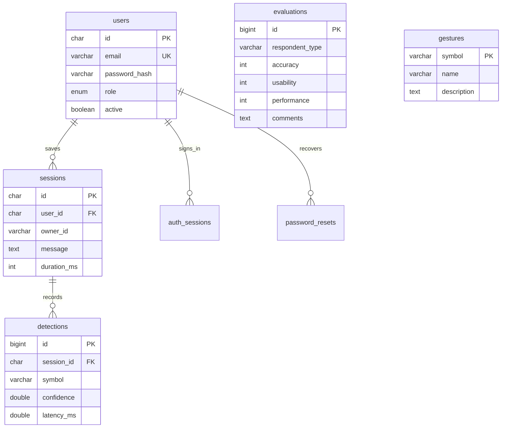

# HandSpeak database

Production uses **MariaDB**, administered through **phpMyAdmin** at `/phpmyadmin/`. phpMyAdmin is a management interface, not the database engine. The application backend remains Python; the browser recognition runs in JavaScript. SQLite is retained only as a local-test fallback and an archived pre-migration recovery copy.

`evaluations` deliberately has no user foreign key, so feedback is not linked to an account. Administrators can read comments. `sessions.user_id` is nullable for guest messages; `owner_id` separates authenticated accounts from anonymous browser cookies. Historical records without an owner remain private. `app_locks` is an internal single-row transaction lock for atomic administrator setup and password resets.

Schema: [schema.sql](schema.sql). Application driver: PyMySQL. The application database account has SELECT/INSERT/UPDATE/DELETE privileges; the separate phpMyAdmin manager account can manage only the HandSpeak database. MariaDB listens on loopback, not the public network.

`HANDSPEAK_MYSQL_CONFIG` points to a private JSON connection file outside the web root. Never commit passwords or SQL dumps. Migration uses `ops/migrate_to_mariadb.py` with the website stopped, imports into an empty database in a transaction, compares every row, and retains SQLite unchanged. After cutover, SQLite is a historical snapshot and must not be used as a current backup.
